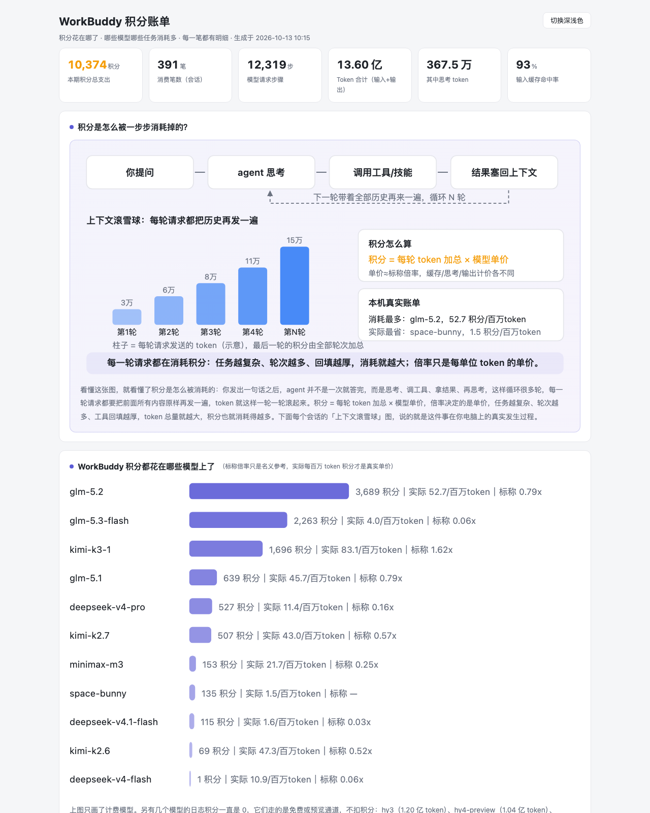
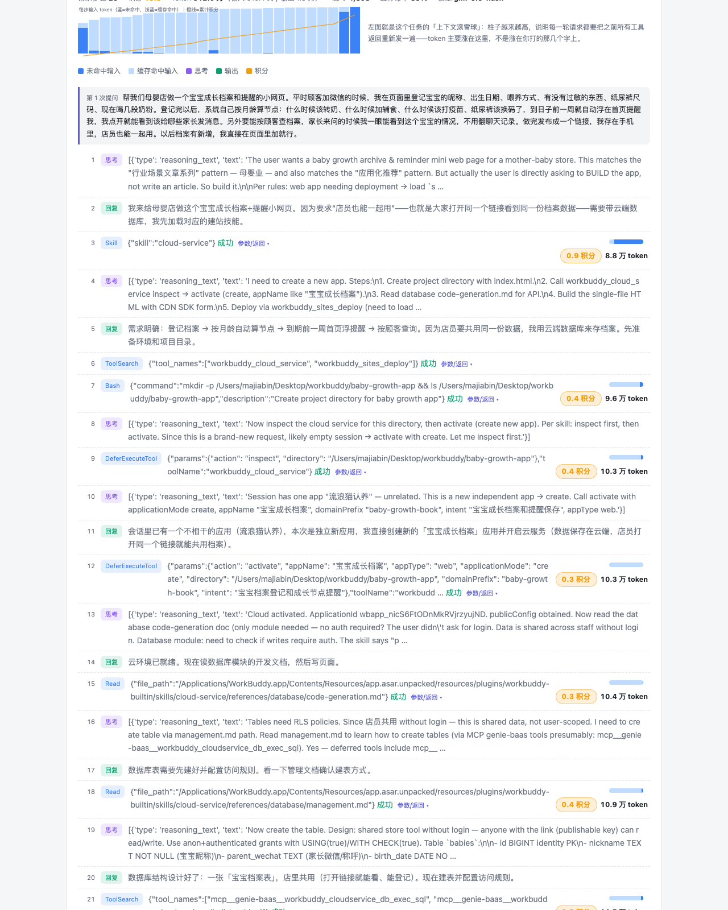

# WorkBuddy Credit Bill（积分账单）

[](LICENSE)
[]()
[]()

一个 WorkBuddy 技能（skill），用于生成本机积分消费账单：以单文件离线 HTML 的形式，展示每段时期、每个模型、每个会话（任务）、每一步模型请求的 token 构成与官方积分明细，帮助你看清「积分到底花在哪了」。

解决的核心问题：**模型倍率低 ≠ 积分消耗少**。积分账单 = 实际消耗的 token 总量 × 模型单价，而 token 总量由任务复杂度、agent 思考轮次、工具/Skill/MCP 调用回填共同决定。本工具把这层关系用你自己的真实数据摊开给你看。



## 功能

- **账单总览**：本期积分总支出、消费笔数（会话数）、请求步骤数、总 token、思考 token、缓存命中率
- **积分消耗过程图解**：SVG 图解 agent 请求生命周期（提问 → 思考 → 调工具 → 结果回填 → 下一轮），直观展示上下文滚雪球与积分公式
- **WorkBuddy 积分都花在哪些模型上了**：按模型汇总消耗积分、token 构成（未命中输入 / 缓存命中 / 思考 / 输出）、实际积分率（积分/百万 token），与官方标称倍率并列对比
- **不同模型的干活节奏**：每条指令平均跑几步、每步背多少 token、平均每条指令花多少积分，三档节奏标签（干脆利落 / 正常节奏 / 步子细密），给模型选型做参考；样本太少的模型只列数据不贴标签，并附公平性说明
- **积分被哪些工具消耗得多**：内置工具 / Skill / MCP / 多代理 / 联网检索五类分色汇总 + 按名称 TOP10
- **每个任务消耗的积分是多少（积分消费明细清单）**：全部会话列表，支持近 7/30/90 天与全部窗口过滤，可按时间或按积分（多→少）排序
- **单笔明细回放**：点任意一笔，逐步回放该任务的完整过程（用户提问、模型思考原文、工具/Skill/MCP 调用与返回、子代理活动），每步带 token 构成色条与积分徽章；顶部为「上下文滚雪球」趋势图
- **免费/预览模型识别**：日志中积分恒为 0 的免费/预览通道模型（如 step、hy、gemini-flash-high 等），会明确标注「不计积分」而非显示 0，避免误读
- **自动化**：首次使用自动在资料库创建固定入口页，并建立每日 09:00 自动刷新的定时任务（覆盖同一节点，不堆积）
- 深浅色主题自适应；思考原文与工具参数默认折叠；单文件输出，离线可打开

## 数据来源与口径

- 解析 WorkBuddy 本机会话日志：`~/.workbuddy/projects/**/*.jsonl`（含子代理日志 `subagents/agent-*.jsonl`）
- 积分取自日志中官方逐请求回传的 `credit` 字段（与 App 账单同源）；token 构成取自 `rawUsage`
- 步骤级分组：`messageId` = 单次模型请求步骤；`conversationRequestId` = 一次用户指令的完整 agent 循环
- 「干活节奏」按指令轮次（`conversationRequestId`）聚合，每轮归入该轮内步数最多的模型；指令数少于 5 的模型不参与标签评定（节奏与交给它的任务难度相关，仅供参考）
- 标称倍率运行时抓取官方文档，失败时回退本地缓存（`scripts/multipliers.json`），再回退内置表
- 全程本地计算，除抓取官方倍率页面外不联网；对话内容不出本机

## 安装

1. 下载本仓库（`Code` → `Download ZIP`，解压）
2. 将 `credit-bill` 文件夹整个复制到 WorkBuddy 技能目录：
   - macOS：`~/.workbuddy/skills/`
   - Windows：`C:\Users\<你的用户名>\.workbuddy\skills\`
   - （`.workbuddy` 为隐藏目录，需开启显示隐藏文件；也可直接把仓库链接发给 WorkBuddy，让 AI 代装）
3. 重启 WorkBuddy

无第三方依赖，Python 3.9+ 标准库即可运行。

## 使用

在 WorkBuddy 对话中说任意一句：

```
看看我的积分花在哪
生成我的积分账单
查积分 / 积分明细 / 用九十天的窗口重新生成账单
```

首次使用会自动生成账单、创建资料库固定入口页，并建立每日 09:00 自动刷新任务。

也可以不经对话、直接命令行运行：

```bash
python3 credit-bill/scripts/gen_report.py --out credit-bill.html

# 可选参数
#   --days N      完整明细回放嵌入最近 N 天的会话（默认 30，0 = 全部历史）
#   --projects D  指定日志目录（默认 ~/.workbuddy/projects）
#   --full        思考原文与工具参数不截断
#   --out PATH    输出路径（默认 credit-bill.html）
```



## 常见问题

**某笔消费显示「不计积分」是出错了吗？**
不是。免费/预览通道的模型，平台逐请求回传的积分就是 0，token 消耗是真实的。积分 0 ≠ 没干活。

**想看更早的任务？**
默认账单只嵌入近 30 天的完整明细，更早的只显示汇总。让 AI「用九十天的窗口重新生成」或「全部历史都要」即可。

**数据会外传吗？**
不会。全部计算在本机完成，输出为本地 HTML 文件，离线可打开。

**AI 说找不到日志？**
说明本机还没有 WorkBuddy 使用记录，或日志目录不在默认位置，可用 `--projects` 指定。

## 致谢

思路参考 [dsh-context](https://github.com/bowenliang123/dsh-context)（DeepSeek Harness 的上下文可视化插件）。

## 作者

老马（马佳彬）· 公众号 / B 站「马佳彬V」持续分享 WorkBuddy 实操玩法

## License

[MIT](LICENSE)
